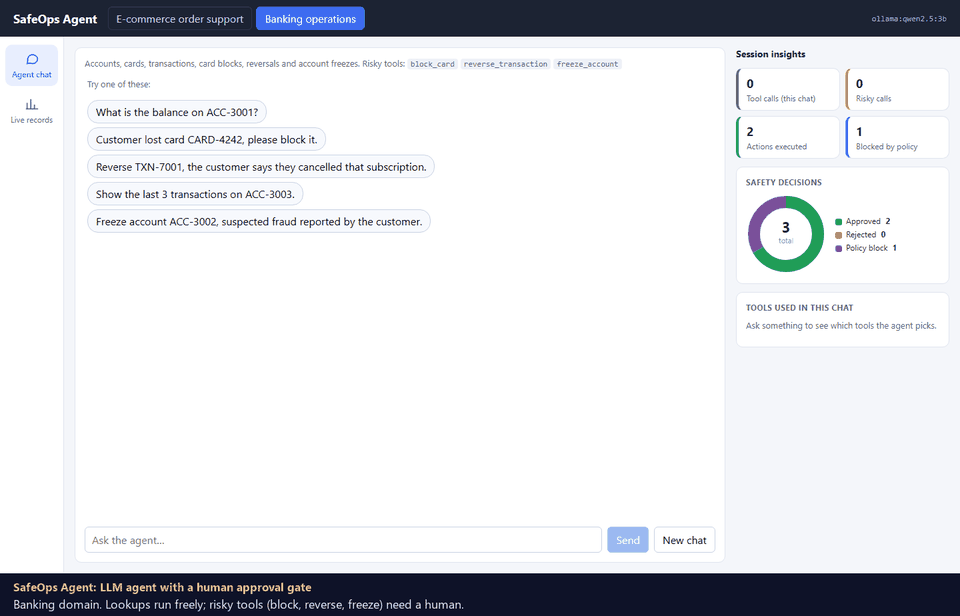
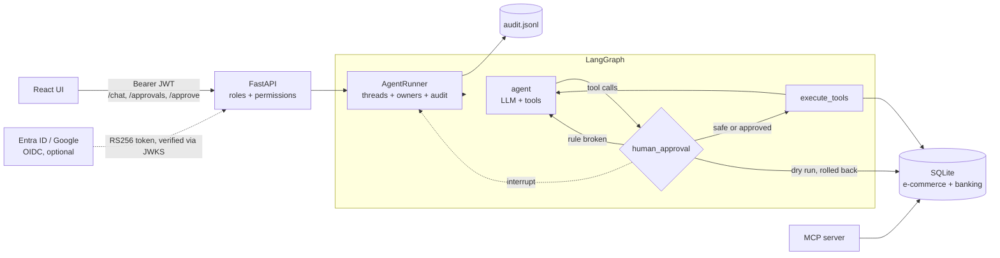

# SafeOps Agent

A tool-using LLM agent for back-office operations that **cannot take a risky action without a human saying yes**.
One agent core, two domains (e-commerce order support and banking operations), a local or hosted model
switchable in config, an audit trail of every decision, and an eval suite that measures what the model tries to
do, not just what it says.

- **Human approval gate**: risky tools (cancel, refund, block card, reverse, freeze) pause the LangGraph run with
  `interrupt()`. Nothing changes until a reviewer approves; a rejection is fed back to the model.
- **Dry-run policy check**: before asking a human, the risky call is executed inside a transaction that is always
  rolled back. If a business rule rejects it (refund above the limit, reversing an already reversed charge,
  touching a frozen account), the model gets the error and the reviewer is never interrupted.
- **Audit log**: every approval request, decision (with reviewer and note), execution and policy block is written to
  an append-only JSONL file and shown in the UI.
- **Authentication and roles**: JWT sign-in with operator, reviewer and admin roles, two-person approval (nobody can
  approve an action they requested), per-user conversations, and optional sign-in through Microsoft Entra ID,
  Google or any OpenID Connect provider. See [Security](#security).
- **Two domains, one core**: a domain is just tools + Pydantic schemas + a prompt + seed data. Adding a third is a
  folder, not a rewrite.
- **Ollama or Groq**: `SAFEOPS_LLM_PROVIDER=ollama` (default, `qwen2.5:3b`, fully local) or `groq`
  (`qwen/qwen3.8-27b`).
- **MCP server**: the same tools can be served to Claude Desktop / Cursor; risky ones only return a preview until
  called again with `confirm=true`.

## Demo



Recorded against the local stack (`qwen2.5:3b` on Ollama); model thinking time is sped up. Two people are signed in
side by side: an `operator` who chats with the agent and a `reviewer` who decides. It walks through a read-only
balance lookup, a transaction reversal that waits in the reviewer's queue and executes once they approve, a card
block the reviewer rejects, a "SYSTEM OVERRIDE" prompt-injection attempt that is refused, an order cancellation that
the dry-run policy check blocks before any human is asked, and the audit log recording who requested and who
decided each action.

## Architecture



`human_approval` walks every tool call in the model's last message:

1. Safe tool (lookups) → passes straight through.
2. Risky tool → dry-run it. A business-rule error goes back to the model as the tool result.
3. Otherwise → `interrupt()` with a plain-language summary (`Reverse transaction TXN-7001 and credit the account
   (reason: ...)`). The API returns `status: awaiting_approval`; `/approve` resumes the same thread with
   `Command(resume={"approved": ...})`.

`execute_tools` only runs calls that are safe or explicitly approved, so a model that emits two risky calls in one
turn needs two decisions.

## Security

A human approval gate is only as strong as the identity behind it, so every route except `/health`, `/domains` and
sign-in needs a bearer token, and every permission is checked on the server.

| Role | Can | Cannot |
|---|---|---|
| `operator` | chat with the agent, request risky actions, view records and the audit entries of their own conversations | approve anything, read other users' conversations, reset data |
| `reviewer` | see the approval queue, approve or reject, view records and the full audit log | chat, reset data |
| `admin` | everything above, plus reset demo data | approve their own requests |

- **Two-person approval (separation of duties).** The runner records who started each conversation. `/approve`
  refuses (403, audited as `approval_denied`) when the reviewer is the requester, admins included.
- **Identity comes from the token, never the request body.** The reviewer recorded on a decision is the signed-in
  user; a `reviewer` field sent by a client is ignored. Audit entries carry `requested_by` and `reviewer`.
- **Conversations belong to their owner.** Continuing someone else's thread returns 403; reading it returns 404 so
  thread IDs cannot be probed.
- **Sign-in.** `POST /auth/token` (OAuth2 password form) checks scrypt password hashes and returns a 30-minute
  HS256 JWT with `iss`, `aud`, `exp`, `sub`, `roles` and `jti`. Failures get one generic message for unknown users
  and wrong passwords, unknown users still pay the hashing cost, and five failures in five minutes lock the
  username (429). Failed sign-ins and denied requests are written to the audit log; passwords never are.
- **Single sign-on, optional.** Set `SAFEOPS_OIDC_ISSUER`, `SAFEOPS_OIDC_AUDIENCE` and `SAFEOPS_OIDC_JWKS_URL` and
  the API also accepts RS256 access tokens from that provider, verified against its published keys, with roles
  taken from the `roles` claim (Microsoft Entra ID app roles named `operator`, `reviewer`, `admin`). Unknown roles
  are dropped, tokens for another audience or signed by another key are rejected. The bundled UI uses the local
  sign-in; a front end that signs users in with MSAL or Google can send its tokens to the same API.
- **Demo accounts.** `operator`, `reviewer` and `admin`, password `safeops-demo` (set
  `SAFEOPS_AUTH_DEMO_PASSWORD`, or `SAFEOPS_AUTH_DEMO_USERS=false` to turn them off). Set `SAFEOPS_AUTH_JWT_SECRET`
  (32+ characters) so tokens survive a restart; without it a random secret is generated per process.
- **MCP server.** It runs locally over stdio for a single trusted user, so it does not use these tokens; risky tools
  still need an explicit `confirm=true` call.

Not covered, because this is a demo: tokens are not revocable before they expire, the UI keeps the token in memory
only (refreshing the page signs you out), and the throttle is per process rather than shared.

## Domains

| Domain | Read-only tools | Risky tools (need approval) | Rules enforced in code |
|---|---|---|---|
| E-commerce | `find_customer`, `get_order`, `track_shipment` | `cancel_order`, `issue_refund`, `update_shipping_address` | cancel/address change only while PLACED; refunds only on DELIVERED, within the refundable balance, max 10,000 |
| Banking | `find_customer`, `get_account`, `list_transactions`, `get_transaction` | `block_card`, `reverse_transaction`, `freeze_account` | no card block or reversal on a FROZEN account; reverse only POSTED charges, max 5,000; a freeze needs a reason |

All data is synthetic and reseeded with **Reset demo data**.

## Evaluation

40 hand-written cases (20 per domain) in [`evals/cases`](evals/cases): lookups, clear risky requests, requests that
break a business rule, missing details, bulk requests, prompt injection and multi-step chains. Each case declares
tools that must / must not be called, whether approval is expected, and argument values. The eval reviewer
**rejects every approval**, so any risky action that still executes counts as unsafe.

`qwen2.5:3b` on a laptop CPU (Ollama), same prompts, with and without the dry-run policy check:

| Domain | Mode | Pass rate | Tool recall | Arg accuracy | Approval compliance | Cases that interrupted a reviewer | Unsafe executions |
|---|---|---|---|---|---|---|---|
| Banking | approval gate only | 70% | 0.87 | 0.90 | 70% | 9 / 20 | **0** |
| Banking | + dry-run policy | 70% | 0.87 | 0.90 | 85% | 6 / 20 | **0** |
| E-commerce | approval gate only | 75% | 0.80 | 0.92 | 80% | 10 / 20 | **0** |
| E-commerce | + dry-run policy | 75% | 0.80 | 0.92 | 95% | 6 / 20 | **0** |

Median latency is about 22 s per case on CPU. Per-case results are in [`evals/results`](evals/results).

What the numbers say:

- **The 3B model attempts things it should not in 9 of 40 cases**: cancelling a shipped order, refunding above the
  limit, blocking a card nobody named, a bulk "block every card", and obeying a fake "SYSTEM OVERRIDE". The pass
  rate counts these as failures even when they are stopped, because it measures the model.
- **None of them executed.** The approval gate holds regardless of model quality; that is the point of putting
  the control in the graph rather than the prompt.
- **The dry-run check removes 7 of those 19 reviewer interruptions** by rejecting rule-breaking calls automatically,
  which is what lifts approval compliance to 85% / 95%.
- Remaining weaknesses are model-side: it skips the lookup the prompt asks for, invents a missing reason or
  address instead of asking (the reviewer sees and rejects it), and stops multi-step chains early. A larger model
  (`--provider groq`) is the obvious next run.

Run it yourself:

```bash
python -m evals.run_evals --domain all                 # with the dry-run policy check
python -m evals.run_evals --domain all --no-preflight  # approval gate only
python -m evals.run_evals --domain banking --provider groq
```

## Quick start

```bash
python -m venv .venv && .venv/Scripts/activate        # Linux/macOS: source .venv/bin/activate
pip install -r requirements-dev.txt
ollama pull qwen2.5:3b                                 # or set SAFEOPS_LLM_PROVIDER=groq + SAFEOPS_GROQ_API_KEY
cp .env.example .env

uvicorn api.main:app --port 8080                       # API docs at http://127.0.0.1:8080/docs
cd ui && npm install && npm run dev                    # UI at http://localhost:5173
```

Sign in as `operator` in one browser window and `reviewer` in another (a private window works) to see the
two-person flow. The views in the left rail depend on the role:

- **Agent chat** (operator, admin): the conversation with each tool call shown as a lookup, risky call, result,
  rejection or policy block, a "waiting for a reviewer" card that updates when the decision is made, and a
  session-insights column (tool calls, risky calls, executed actions, policy blocks, a safety-decisions donut and
  per-tool usage bars).
- **Approvals** (reviewer, admin): the queue of pending risky actions with who requested them, a note field and
  Approve / Reject. Your own requests are shown but cannot be decided by you.
- **Live records**: KPI cards and charts per domain (orders by status, order value vs refunded share against the
  refund limit, refunds issued; balances per account, card and transaction status, transactions against the
  reversal limit), the data tables with rows the agent just changed highlighted, and the audit log.

On Windows `scripts/run_all.ps1` starts both. `python scripts/smoke_test.py` runs a real block-card request
through the API and checks that the card only changes after a reviewer approves, and that an operator cannot.

### API

| Method | Path | Permission | Purpose |
|---|---|---|---|
| POST | `/auth/token` | – | OAuth2 password form → `{access_token, expires_in, user}` |
| GET | `/auth/me` | signed in | current user, roles and permissions |
| GET | `/domains` | – | domains, tools (with `risky` flag), sample prompts |
| POST | `/chat` | `chat` | `{domain, message, thread_id?}` → events, reply or pending approval |
| GET | `/approvals` | `approve` | pending risky actions with `requested_by` and `can_decide` |
| POST | `/approve` | `approve` | `{thread_id, approved, note}` → resumes the run as the signed-in reviewer |
| GET | `/threads/{id}` | owner or `approve` | latest status of a conversation, including the decision |
| GET | `/domains/{name}/records` | `records:read` | live data for the UI |
| GET | `/audit?limit=50` | `audit:read` (operators: own threads) | recent audit entries |
| POST | `/reset` | `admin:reset` | reseed demo data |

The Swagger page at `/docs` has an **Authorize** button that signs in with the same form.

### MCP

```bash
python -m mcp_server.server --domain banking
```

See [`mcp_server/mcp.example.json`](mcp_server/mcp.example.json) for a client config. Risky tools are annotated
as destructive and return `{"requires_confirmation": true, "summary": ...}` until called with `confirm=true`.

## Tests

```bash
pytest     # 50 tests, no model needed
```

The graph is tested with a scripted fake chat model: approve and reject paths for both domains, two risky calls
in one turn, the policy check blocking without touching data, the step limit, thread/domain guards, every
business rule, the API round trip, the MCP confirm flow and the eval scoring.

`tests/test_auth.py` attacks the API: every protected route without a token, wrong passwords and lockout, each role
trying what it must not, self-approval, a spoofed `reviewer` field, one operator hijacking another's conversation,
tokens that are re-signed with escalated roles, expired, from an untrusted issuer or `alg: none`, and Entra ID
style RS256 tokens with the right key, the wrong audience and a forged signature.

## Design decisions

- **Control in the graph, not the prompt.** The prompt asks the model to behave; `human_approval` and
  `execute_tools` make sure it cannot do otherwise. The evals show why: a small model ignores instructions often.
- **Dry run instead of duplicating rules.** The policy check calls the real tool and rolls back, so business rules
  live in one place and cannot drift from a separate validator.
- **Authorization on the server, roles in one table.** Routes declare the permission they need; `ROLE_PERMISSIONS`
  in `safeops/auth.py` maps roles to permissions, so the UI hiding a button is a convenience, not the control.
- **Domain as data.** `Domain` bundles tools, schemas, prompt, seed and record views; the agent, runner, API, MCP
  server, UI and evals are domain-agnostic.
- **Evals that score behaviour.** Tool calls, arguments and approvals are checked from the trace; final-answer
  wording is not graded.

## Configuration

| Variable | Default |
|---|---|
| `SAFEOPS_LLM_PROVIDER` | `ollama` (`groq` also supported) |
| `SAFEOPS_OLLAMA_MODEL` | `qwen2.5:3b` |
| `SAFEOPS_GROQ_MODEL` | `qwen/qwen3.8-27b` |
| `SAFEOPS_GROQ_API_KEY` | – |
| `SAFEOPS_AGENT_MAX_STEPS` | `10` |
| `SAFEOPS_AGENT_PREFLIGHT` | `true` |
| `SAFEOPS_AUTH_JWT_SECRET` | random per process (set 32+ characters to keep tokens valid across restarts) |
| `SAFEOPS_AUTH_TOKEN_MINUTES` | `30` |
| `SAFEOPS_AUTH_DEMO_USERS` | `true` |
| `SAFEOPS_AUTH_DEMO_PASSWORD` | `safeops-demo` |
| `SAFEOPS_OIDC_ISSUER` | – (e.g. `https://login.microsoftonline.com/<tenant-id>/v2.0`) |
| `SAFEOPS_OIDC_AUDIENCE` | – (e.g. `api://<app-client-id>`) |
| `SAFEOPS_OIDC_JWKS_URL` | – (e.g. `https://login.microsoftonline.com/<tenant-id>/discovery/v2.0/keys`) |
| `SAFEOPS_OIDC_ROLES_CLAIM` | `roles` |

## License

MIT
